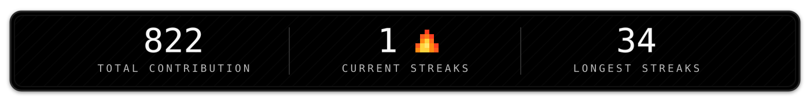

  
  

  
  

<!-- 
  -->

  <!--  -->
  
  &nbsp;&nbsp;&nbsp;&nbsp;
  
  &nbsp;&nbsp;&nbsp;&nbsp;
  
  &nbsp;&nbsp;&nbsp;&nbsp;
  <!--  -->
  <!-- &nbsp;&nbsp; -->
  
  
  <!-- &nbsp;View Resume -->
  <!-- &nbsp;&nbsp;&nbsp;&nbsp; -->
  <!--  -->

